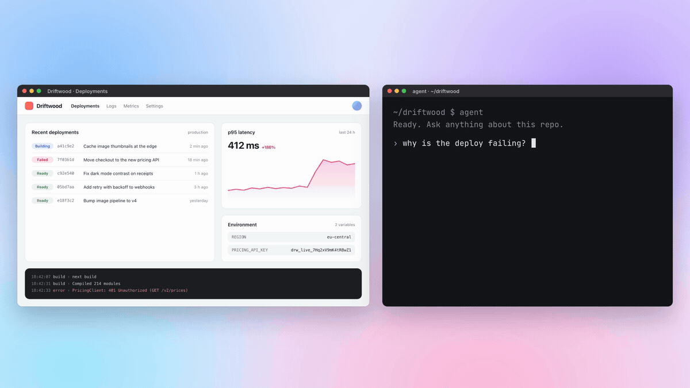
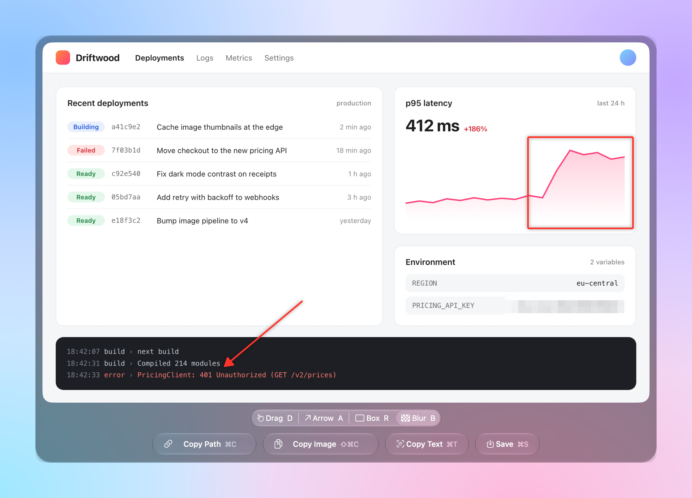
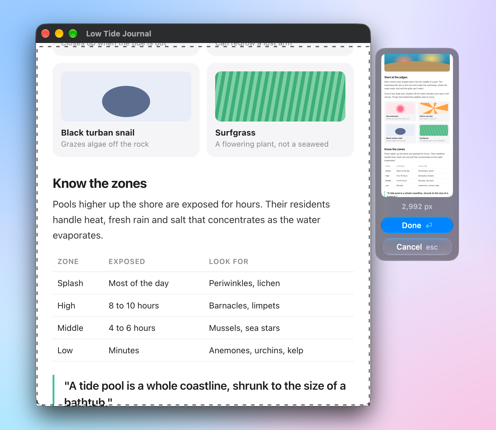
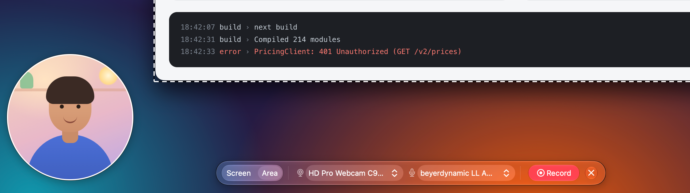
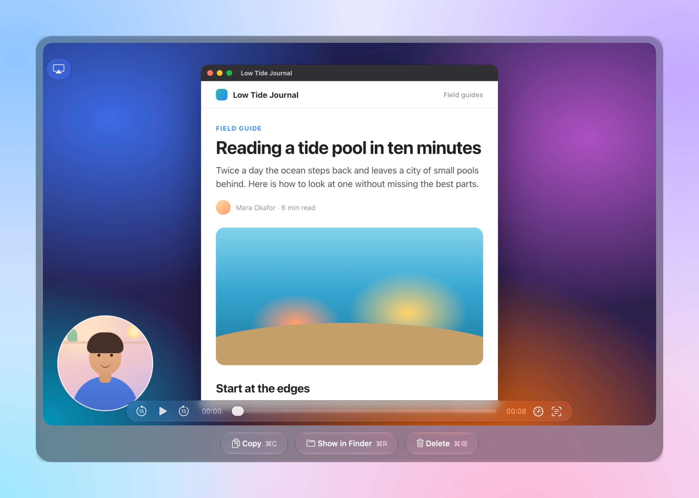

# Screengrab

Screenshot to AI agent in three keystrokes. A macOS menu bar app.



1. Press **Cmd+Shift+2** and drag over what you want to show.
2. Press **Cmd+C**. The preview closes and the screenshot's file path is on your clipboard.
3. Press **Cmd+V** in your terminal. Claude Code, Codex, or any other agent reads the image from that path.

That loop is the whole app most days. The rest is there for the days you need it: markup and blur, scrolling capture, text recognition, and screen recording with a camera bubble. Everything runs on your Mac.

Requires macOS 26 (Tahoe) or later. The release is a universal binary for Apple silicon and Intel.

## Install

```
brew install --cask FlorianRiquelme/tap/screengrab
```

Then set it up once:

1. Open Screengrab from `/Applications`, or run `open -a Screengrab`. It has no Dock icon and appears in the menu bar.
2. Press **Cmd+Shift+2**. macOS asks for Screen Recording permission. Grant it in System Settings.
3. If captures still fail after that, quit Screengrab from the menu bar and open it again.
4. To have it start with your Mac, choose **Launch at Login** in its menu.

The app is not notarized by Apple, because that needs a paid developer account. The cask removes the quarantine flag after install so macOS opens it without complaint. If you download the zip from [Releases](https://github.com/FlorianRiquelme/screengrab/releases) instead, remove the flag yourself:

```
xattr -dr com.apple.quarantine /Applications/Screengrab.app
```

## The core loop

**Cmd+Shift+2** dims every screen. Drag on any of them, or press **Space** and click a window. The screenshot opens in a preview panel in the middle of the screen, and **Cmd+C** (Copy Path) saves it to `~/Library/Caches/Screengrab/`, copies the path, and closes the panel. Esc throws the screenshot away.

Copy Path saves at 1x. A Retina capture at 2x costs an agent about four times the image tokens and shows no text it could not read at 1x. Hold **Option** while copying to keep full resolution.

**Cmd+Shift+1** captures the same area or window again without selecting, which is handy when you iterate on a UI and show the agent each attempt.

## When you need more

### More ways out of the preview



- **Copy Image** (Shift+Cmd+C) copies the PNG itself.
- **Copy Text** (Cmd+T) runs on-device text recognition and copies the text.
- **Save** (Cmd+S) asks where to save the PNG.
- Drag the image out of the panel to drop it into Finder or another app.

Option flips the resolution of both copy buttons. Copy Path keeps full resolution and Copy Image drops to 1x.

### Mark up and redact

Pick a tool above the buttons and drag on the screenshot. **Arrow** (A), **Box** (R), and **Blur** (B) draw in a bold red that scales with the image. Blur pixelates the area into large blocks, so the hidden text is gone from the file. Cmd+Z undoes and Shift+Cmd+Z redoes. Every copy, save, and drag gives the marked-up image.

### Scrolling capture



Press **Cmd+Shift+8** and drag over the content you want, then scroll the app underneath from top to bottom. A panel beside the area shows the stitched page as it grows. Press **Enter** to open the result in the preview. Toolbars and sticky headers that stay in place appear once.

### Screen recording



Press **Cmd+Shift+7** to open the recording bar. Record a whole display or an area, with a camera and a microphone of your choice. The camera bubble and click ripples are part of the video. The bar and the area outline are not. While recording, the bar shows the elapsed time, a mute toggle, and **Stop**.



Recordings go to `~/Movies/Screengrab/`. When one finishes, it opens in a preview where **Copy** puts the file on the pasteboard, ready to paste into a chat or an email.

## Shortcuts

| Shortcut | Action |
| --- | --- |
| Cmd+Shift+2 | Capture an area, or press Space for a window |
| Cmd+Shift+1 | Repeat the last capture |
| Cmd+Shift+8 | Scrolling capture |
| Cmd+Shift+7 | Open the recording bar, or stop a recording |

In the screenshot preview:

| Key | Action |
| --- | --- |
| Cmd+C | Copy Path (Option: full resolution) |
| Shift+Cmd+C | Copy Image (Option: 1x) |
| Cmd+T | Copy Text |
| Cmd+S | Save |
| D, A, R, B | Drag, Arrow, Box, Blur |
| Cmd+Z, Shift+Cmd+Z | Undo, redo |
| Esc | Back to Drag, then close |

The shortcuts live in one table in `Sources/Screengrab/HotKeys.swift`.

## Permissions

- **Screen Recording**, for screenshots and recordings. Without it, a capture shows an alert that opens the setting.
- **Camera**, for the bubble.
- **Microphone**, for recording audio.

## Build from source

You need macOS 26 and Swift 6.2 or later, from Xcode or the Command Line Tools.

```
scripts/setup-signing.sh   # once
scripts/build.sh
```

`build.sh` builds a universal release binary, assembles and signs `build/Screengrab.app`, and installs it to `~/Applications`. `setup-signing.sh` adds a self-signed "Screengrab Local Signing" identity to your login keychain. With it, macOS keeps the privacy permissions across rebuilds. Without it, the build is ad-hoc signed and macOS asks again after every rebuild.

`scripts/test.sh` runs the test suite.

`Screengrab --open <path>` opens an image or a `.mov` in the matching preview.

## License

[MIT](LICENSE)
